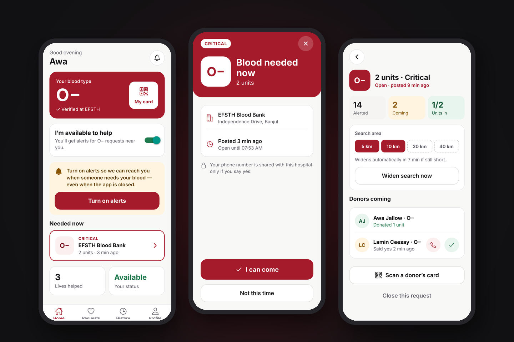
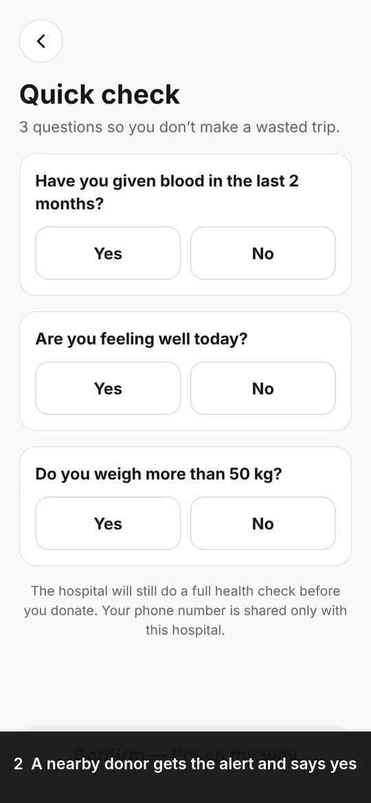
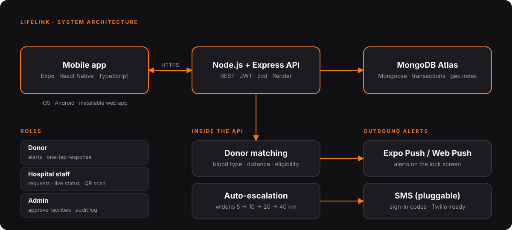

# LifeLink

[](https://github.com/MadiCeesay/LifeLink/actions/workflows/ci.yml)

**Emergency blood donor alerts for The Gambia.** A verified hospital posts an urgent request, LifeLink alerts eligible donors of that blood type nearby, and a donor says yes in one tap. The hospital sees, live, who is coming.

**Live app:** [lifelink-gm.vercel.app](https://lifelink-gm.vercel.app) (installable on any phone) · **API:** [lifelink-api-9t3r.onrender.com](https://lifelink-api-9t3r.onrender.com/api/v1/health) · **Case study:** [madi-ceesay-portfolio.vercel.app/projects/lifelink](https://madi-ceesay-portfolio.vercel.app/projects/lifelink)



[](docs/media/demo.mp4)
*[▶ Watch the 20-second demo](docs/media/demo.mp4): hospital posts a request → donor accepts → hospital sees who is coming (recorded from the real app with sample data).*

## Why

Urgent blood requests in The Gambia often travel as WhatsApp messages and shared lists of donors' names, phone numbers and blood types. That is slow, it exposes donors' personal details, and hospitals can't see who is actually on the way. LifeLink replaces the list with targeted, private alerts.

## How it works

1. **Hospital posts a request** (blood type, units, urgency) in about 30 seconds.
2. **LifeLink alerts matching donors nearby.** The search starts at 5 km and widens automatically to 10, 20 and 40 km every ten minutes while not enough donors have accepted.
3. **A donor answers three eligibility questions and taps "I can come"**, then gets directions and a call button.
4. **The hospital sees live counts** (alerted, coming, units received), scans the donor's QR card and confirms the donation. The donor is paused from matching for 56 days.

## Privacy by design

- No public donor list. Matching by blood type and distance happens on the server only.
- Exact locations are never shown. A hospital sees a donor's contact details only after that donor accepts.
- Blood types are confirmed in person by a facility (QR card scan), not self-declared.
- Every sensitive admin action is written to an audit log. The QR card contains only an opaque ID.

## Architecture



| Layer | Technology |
| --- | --- |
| App | Expo SDK 58 (React Native + Expo Router), TypeScript, React Query, react-hook-form + zod. One codebase for an installable web app (PWA) and native Android/iOS builds via EAS |
| API | Node.js 22, Express 5, zod validation, JWT auth with token versioning, helmet, rate limiting |
| Data | MongoDB Atlas with Mongoose; replica-set transactions for request, response and donation state changes; 2dsphere indexes for distance matching |
| Alerts | Web Push (VAPID) in the browser, Expo push in store builds; SMS one-time codes through a pluggable provider (`none`, `console`, `twilio`) |
| Hosting | API on Render, app on Vercel, database on MongoDB Atlas |

### Roles

| Role | Can do |
| --- | --- |
| Donor | Sign up with a phone number, set availability, receive alerts, accept or decline, keep a QR donor card and donation history |
| Facility staff | Verify donor blood types in person, create and broadcast requests, coordinate donors, confirm donations (per-permission access) |
| Admin | Approve facilities, provision staff and permissions, view the audit log |

### Engineering notes

- **Progressive search without alert fatigue.** A background job widens the radius only while accepted donors < units needed. Broadcasts are idempotent and recorded, so a donor is never alerted twice for the same request.
- **Consistent state under concurrency.** Accepting, cancelling and confirming donations run in MongoDB transactions, so unit counts and request status can't drift.
- **Web and native from one codebase.** Native-only modules (notification taps, camera) are isolated so they never load on the web build.
- **Documented API.** The full OpenAPI 3.0 spec is served at `/api/v1/docs/openapi.json`, and a test fails if any route is undocumented. See [`backend/docs/API_ENDPOINTS.md`](backend/docs/API_ENDPOINTS.md).

## Project structure

```
backend/    Express API: routes → controllers → services → Mongoose models
  docs/     OpenAPI spec, architecture, security review
  tests/    Vitest + supertest, in-memory MongoDB replica set
frontend/   Expo app: app/ (screens via Expo Router), src/ (API client, features, components)
render.yaml Render blueprint for the API
```

## Run locally

Requirements: Node.js 22 and a MongoDB replica set (a free MongoDB Atlas cluster works).

```bash
# API
cd backend
cp .env.example .env        # set MONGODB_URI and a 32+ character JWT_SECRET
npm install
npm run dev                 # http://127.0.0.1:5000/api/v1/health
npm run bootstrap:admin     # once: creates the first admin interactively

# App
cd ../frontend
cp .env.example .env        # EXPO_PUBLIC_API_URL=http://127.0.0.1:5000/api/v1
npm install
npx expo start --web        # or scan the QR code with Expo Go
```

Optional settings in `backend/.env.example`: push keys (`VAPID_*`), SMS (`SMS_PROVIDER`, `TWILIO_*`), radius stages (`MATCH_RADIUS_STAGES_KM`) and escalation interval (`AUTO_ESCALATE_MINUTES`).

## Tests

```bash
cd backend  && npm test          # API, matching, auth, security (spins up an in-memory MongoDB replica set)
cd frontend && npm run check     # TypeScript, ESLint and unit + API integration tests
```

CI runs both on every push.

## Deploy

1. **Database:** create a MongoDB Atlas cluster and database user, and copy the connection string.
2. **API:** on Render, *New → Blueprint* and select this repo (reads `render.yaml`). Set `MONGODB_URI`, `JWT_SECRET` and `CORS_ORIGINS` (your app URL).
3. **First admin:** run `npm run bootstrap:admin` once from your own machine with the production `MONGODB_URI` in `backend/.env`.
4. **App:** import the repo on Vercel with root directory `frontend` and set `EXPO_PUBLIC_API_URL=https://<your-api>/api/v1`.
5. **Install:** open the app URL on a phone and choose *Add to Home Screen* (Safari) or *Install app* (Chrome).

Render's free plan sleeps when idle, so the first request after a pause can take up to a minute; the app warms the API up on launch.

## Roadmap

- Android and iOS store releases (EAS profiles are already configured)
- SMS alerts for donors without smartphones
- Pilot with a hospital blood bank and the national blood transfusion service

## Author

Built by **Madi Ceesay**: [portfolio](https://madi-ceesay-portfolio.vercel.app) · [GitHub](https://github.com/MadiCeesay)
