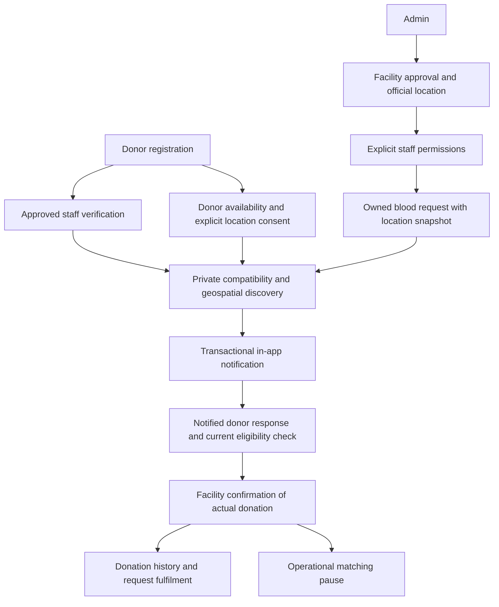

# Architecture and operations

## Trust and flow

Node/Express modular monolith, MongoDB replica set/sharded topology, Mongoose, ES modules. Controllers only delegate and wrap responses; Zod validators reject unknown fields; services enforce fresh permissions/ownership and business transitions. No public donor directory/search or patient medical-record model exists.

## Models and relationships

- User: DONOR/FACILITY_USER/ADMIN, identity/hash/active/session version; at most one facility plus explicit permissions; donor verification snapshot, independent availability/consent, private current location/timestamp and last confirmed donation.
- Facility: administrative identity/reference/type, PENDING/APPROVED/REJECTED/SUSPENDED lifecycle, active flag, approval/status provenance, admin-managed official Point.
- VerificationEvent: immutable donor/facility/staff transition history with sequence unique per donor. Current snapshot and event commit together.
- BloodRequest: owner facility/creator, patient blood type (no identity), requested/received units, staff urgency, location snapshot, expiry and terminal timestamps; internal mutation/broadcast state.
- Broadcast: request + UUID idempotency key unique, initiator and minimized counts/radius.
- Notification: request/donor/channel unique; real in-app availability/read timestamps. Only donor-owned reads.
- DonorResponse: request/donor unique, notification link, final ACCEPTED/DECLINED state; absence derives PENDING.
- Donation: immutable request/donor unique, accepted response, facility/confirming staff/time, units and blood-type snapshot.
- AuditLog: immutable safe actor/action/target/facility/time/allowlisted metadata.
- AdminBootstrap: singleton marker atomically protects initial administrator creation.

## Lifecycles

Facility: creation PENDING; PENDING->APPROVED/REJECTED; APPROVED->SUSPENDED; SUSPENDED->APPROVED via reactivate; REJECTED->PENDING via reactivate. Approving twice/reopening invalid states is rejected. Suspended/inactive/unapproved facilities cannot perform trusted operations. Past donor verification records are not automatically rewritten on facility suspension; explicit review/reclassification is required.

Donor: UNVERIFIED/REQUIRES_REVERIFICATION->VERIFIED only by approved authorized staff; VERIFIED->SUSPENDED/REQUIRES_REVERIFICATION by admin; UNVERIFIED or REQUIRES_REVERIFICATION->SUSPENDED by admin; SUSPENDED->REQUIRES_REVERIFICATION by admin. Staff cannot bypass suspension; blood-type correction requires the reverification lifecycle and another immutable event. Verification is not clinical clearance.

Request: OPEN->PARTIALLY_FILLED/FULFILLED only from confirmed units; OPEN/PARTIALLY_FILLED->CANCELLED by owner management; either active state becomes effectively EXPIRED at expiresAt even before optional persistence cleanup. Terminal requests cannot create new notifications/responses/donations. An identical already-recorded donation retry remains idempotent after fulfilment.

Response: no row means PENDING; first ACCEPTED/DECLINED is final. Identical active-request retries are idempotent; changes are conflicts. Notification read state is independent. Acceptance never increments received units.

## Permission matrix

| Operation | Role / requirements |
|---|---|
| Own availability/location/status/history/inbox | Active DONOR, own record only |
| Facility verification lookup/write/history | Active FACILITY_USER, approved active associated facility, VERIFY_DONORS; history scoped to own facility |
| Create request | Same facility conditions + CREATE_BLOOD_REQUESTS + stored official location |
| Cancel/broadcast/accepted-contact response view | Same facility conditions + MANAGE_BLOOD_REQUESTS + request ownership |
| Confirm donation/read own request donation records | Same facility conditions + CONFIRM_DONATIONS + ownership/accepted donor |
| Facility approval/location/provisioning/permissions, account controls, audit/stats | Active ADMIN; deliberate endpoints, not a universal bypass of clinical staff actions |

## Transactions and concurrency

Privileged transactions acquire current actor/facility write guards, then target/request guards where relevant; donor-specific acceptance/confirmation also guard donor state. MongoDB write conflicts retry through Mongoose transactions. Account deactivation, facility suspension and permission changes conflict with trusted mutation guards rather than trusting stale JWT roles. Request mutationVersion serializes cancellation, broadcast, response and donation/fulfilment. Unique indexes provide a second line of defense.

GeoNear is outside the transaction because of MongoDB's operator restriction. Broadcast rechecks the bounded indexed candidate set inside the transaction while acquiring donor write guards; optional accept-location refresh is part of its transaction and retains the last-donation pause field. No external network delivery occurs while holding a transaction. Atlas latency, transaction timeouts and heavy workloads require performance review before production.

Location mutation uses one atomic conditional update on an active donor, requiring consent for upload. Revocation/deletion disables consent and unsets both fields in the same write. Availability updates affect only availability, so independent racing choices are preserved. No global location tracking/history or stale-eligibility cache is introduced.

Donation event, units/status/timestamps, private lastConfirmedDonationAt and audit all commit or all roll back. One event per request/donor and request locking prevent double counting/overfill. Future correction workflow must append explicit compensating records; silent edits are not available.

## Index review

| Collection | Index purpose |
|---|---|
| users | Unique normalized email; facility+role membership; role+isActive counts; currentLocation 2dsphere |
| facilities | verificationStatus + creation time/ID for admin listing |
| verificationevents | Unique donor+sequence; facility+donor+sequence history |
| bloodrequests | facility+creation time/ID owner listing; status+expiresAt activity/cleanup |
| broadcasts | Unique request+idempotency key |
| notifications | Unique request+recipient+channel; recipient+creation time/ID inbox |
| donorresponses | Unique request+donor; request+response time/ID paging |
| donations | Unique request+donor; donor+confirmation time/ID; facility+confirmation time/ID |
| auditlogs | timestamp+ID; action+timestamp+ID; facility+timestamp+ID |
| adminbootstraps | Unique singleton _id |

No speculative compound geospatial index or redundant index removal was performed. Real explain checks confirm GEO_NEAR_2DSPHERE on currentLocation_2dsphere. Exact-distance ties use donor ID. Counts remain database queries; no donor collection is loaded into Node to calculate every distance.

## Reliability and deployment

Startup: validate environment -> connect required MongoDB -> assert transaction-capable topology -> initialize indexes -> bind HTTP. Missing/failed DB cannot yield a listening healthy server. Readiness checks connection state; error mapping is fail-closed. Graceful shutdown closes HTTP (10-second connection deadline) then MongoDB. Existing automated tests execute actual HTTP startup/shutdown and unavailable-DB startup rejection against disposable instances.

No cron is required for correctness: expiry and pause are checked at action/query time. No external notification delivery or retry is simulated. In-memory rate limiting is single-process; a multi-instance deployment needs a reviewed shared rate-limit strategy, not an unannounced infrastructure dependency. Database backup/restore, replica availability, credentials, TLS, monitoring, retention and clinically governed policies remain deployment responsibilities.
